# Quanto Cobro?

**Calculadora gratuita de orçamento para designers e freelancers brasileiros.**
Em vez de planilha ou preço no improviso, você informa valor por hora, horas de trabalho, revisões, prazo e custos, e chega a uma **referência de cobrança explicável**. Depois, transforma o resultado numa **proposta** pronta para enviar ao cliente.

**▶ Testar agora:** https://clleytonbraga.github.io/quanto-cobro-calculadora/

Sem login, sem cadastro, sem backend: tudo roda no navegador. O produto é gratuito e monetizado por publicidade, sempre fora da tarefa principal.

<p align="center">
  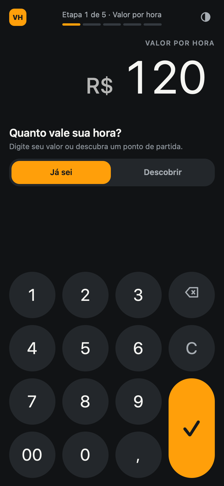
  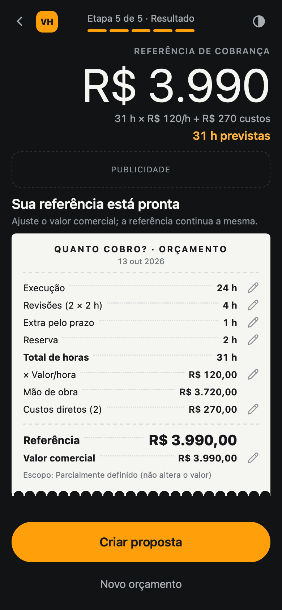
  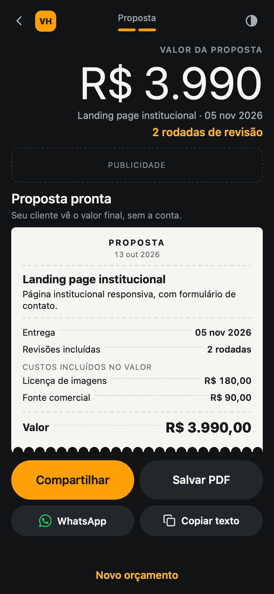
</p>

---

## Como funciona

A ferramenta parece uma calculadora: o **visor** é o próprio campo e mostra o subtotal a cada etapa.

| Etapa | O que você informa |
| --- | --- |
| 1 · Valor por hora | Quanto vale sua hora, ou descubra um ponto de partida (meta mensal ÷ horas faturáveis) |
| 2 · Execução | Horas de trabalho, sem revisões, e o nível de definição do escopo (opcional) |
| 3 · Prazo e revisões | Data de entrega, rodadas × horas por rodada, horas extras exigidas pelo prazo |
| 4 · Ajustes | Reserva para incerteza e custos diretos (licenças, fontes, impressão…) |
| 5 · Resultado | Cupom com a composição completa; cada linha é editável ali mesmo |

**A conta, sem percentuais mágicos:**

```text
horas_revisão  = rodadas × horas_por_rodada
horas_totais   = execução + horas_revisão + extras_pelo_prazo + reserva
referência     = horas_totais × valor_hora + custos_diretos
```

A data de entrega e o nível de escopo **não mudam o preço**. O **valor comercial** (o que vai para a proposta) começa igual à referência e pode ser ajustado sem alterá-la. Dinheiro é calculado em centavos inteiros, com um único arredondamento no fim.

### Proposta
Depois do resultado, você preenche nome do projeto, resumo do escopo e observações. A proposta sai como um cupom e pode ser **compartilhada** (menu nativo do celular), enviada pelo **WhatsApp**, **copiada** para qualquer app de mensagem ou **salva em PDF**. A matemática interna não aparece para o cliente.

### O que fica salvo
- **No aparelho:** valor por hora e tema claro/escuro.
- **Só nesta aba:** o orçamento em andamento. Recarregar a página não perde nada; fechar a aba descarta. Não há histórico nem envio de dados a servidores.

---

## Telas

### Mobile, uma dobra por tela

| Valor por hora | Execução | Prazo e revisões | Ajustes |
| --- | --- | --- | --- |
|  | 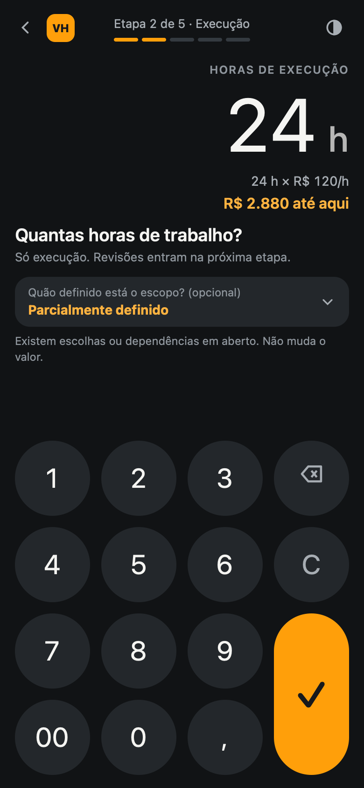 | 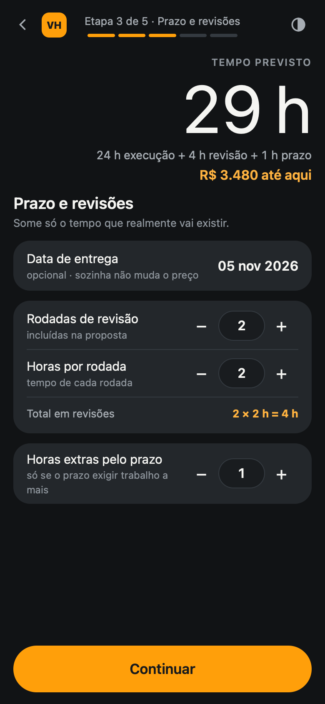 | 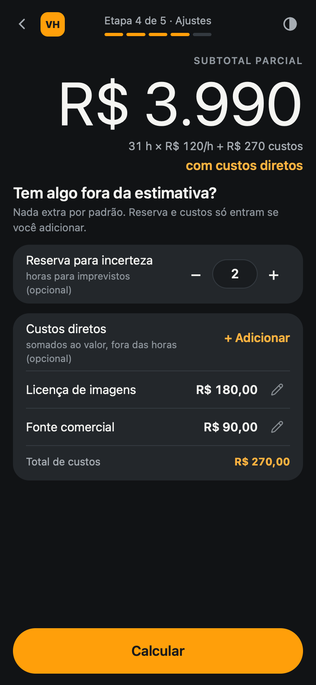 |

| Resultado (cupom) | Proposta | Calendário (modal) | Novo custo (modal) |
| --- | --- | --- | --- |
|  |  | 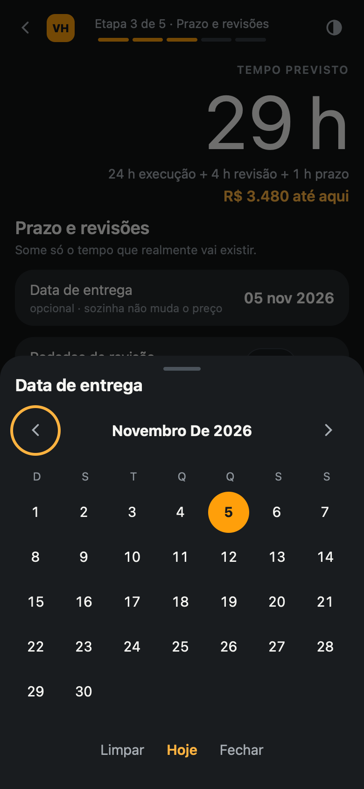 |  |

Tema claro: <br>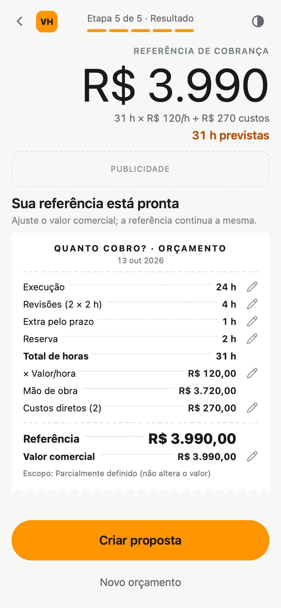

### Desktop
Trilha de etapas à esquerda, calculadora no centro e **orçamento impresso ao vivo** à direita.

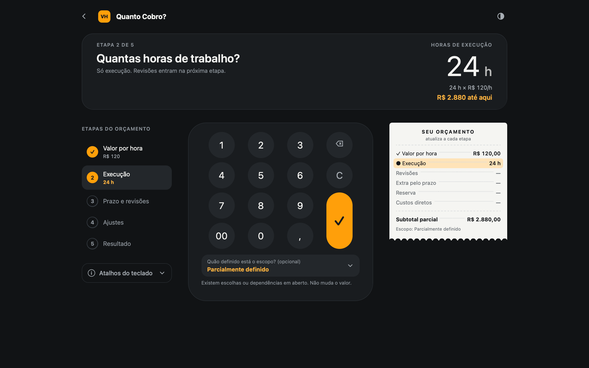
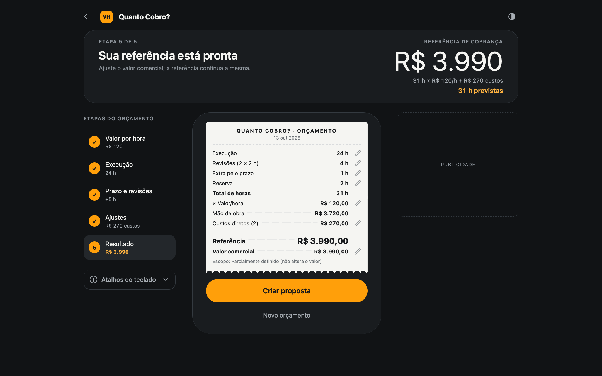
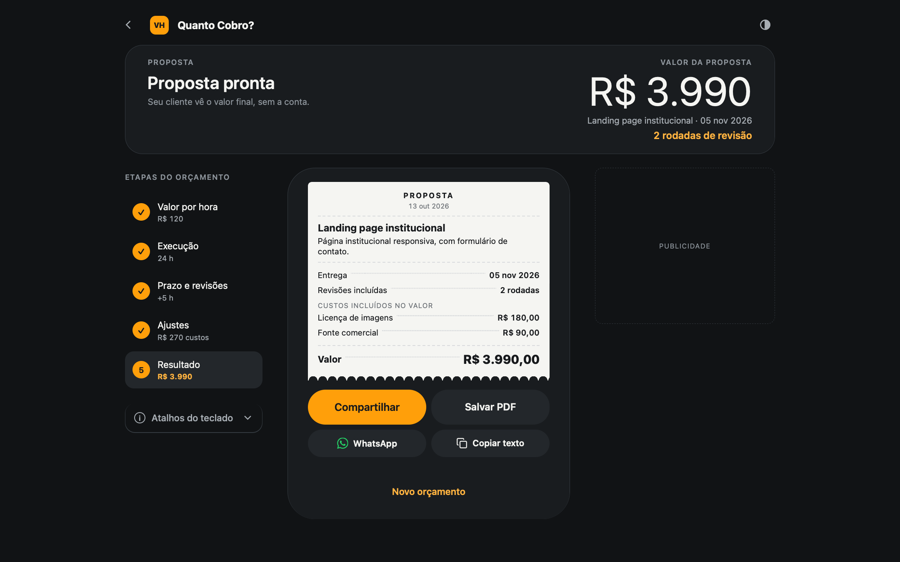

Atalhos no desktop: dígitos, `,` e `00` para digitar, `↑ ↓` somam/subtraem 1, `Enter` confirma, `Backspace` corrige e `Esc` volta.

---

## Rodar localmente

Não há build nem dependências. Basta servir a pasta:

```bash
python3 -m http.server 8790
# abra http://localhost:8790
```

Qualquer servidor estático serve (`npx serve`, GitHub Pages, Vercel, Netlify). Abrir o `index.html` direto do disco não funciona, porque módulos ES exigem HTTP.

### Testes

```bash
node test.mjs                 # regras de cálculo, entrada, proposta e datas
node docs/calc-reference.mjs  # casos contratuais do Business Rules
```

---

## Estrutura

```text
index.html        página única; a rota / é a calculadora
styles.css        tokens do Design System (dark/light) e layouts mobile/desktop
calc.js           regras de negócio puras (sem DOM), testadas por test.mjs
app.js            estado, telas, modais e eventos
test.mjs          testes com node:assert, sem framework
docs/             PRD, arquitetura, Business Rules, Design System, handoff e decision log
docs/screenshots  imagens deste README
docs/historico    versões anteriores dos documentos e materiais de apoio
```

HTML, CSS e JavaScript puros, sem framework nem dependências. O desenho de ícones vem do [Lucide](https://lucide.dev) (ISC) e do [Simple Icons](https://simpleicons.org) (CC0).

---

## Documentação

| Documento | Para quê |
| --- | --- |
| [Decision Log](docs/decision-log.md) | Decisões aprovadas QC-DEC-001 a 021 e histórico; **fonte de verdade** em caso de conflito |
| [Business Rules](docs/business-rules.md) | Validações, obrigatórios, arredondamento, limites, persistência e casos-teste |
| [PRD](docs/PRD.md) | Escopo do MVP, jornadas e métricas |
| [Arquitetura](docs/architecture.md) | Modelo de dados, função de cálculo e rotas |
| [Design System](docs/design-system.md) | Tokens, componentes, estados e vocabulário de interface |
| [Handoff técnico](docs/handoff_tecnico.md) | Contratos e critérios de aceite |
| [Leia primeiro](docs/LEIA_PRIMEIRO.md) | Guia de leitura do pacote (nesta pasta, `atuais/` = `docs/`) |

### Design

| Arquivo | Link |
| --- | --- |
| Figma: arquivo | https://www.figma.com/design/87RIlysRO3vHEDm7Ghdzf3 |
| Figma: Mobile v1.4 | https://www.figma.com/design/87RIlysRO3vHEDm7Ghdzf3?node-id=100-2 |
| Figma: Desktop, Variante D (aprovada) | https://www.figma.com/design/87RIlysRO3vHEDm7Ghdzf3?node-id=115-2 |
| Figma: variações de desktop A–D | https://www.figma.com/design/87RIlysRO3vHEDm7Ghdzf3?node-id=107-2 |
| FigJam: fluxos e sitemap | https://www.figma.com/board/LoGu3vG6gQtt9KEGnAJ9CA?node-id=17-389 |
| FigJam: atualização das regras | https://www.figma.com/board/LoGu3vG6gQtt9KEGnAJ9CA?node-id=26-639 |

Os arquivos do Figma são privados; o acesso depende de convite.

---

## Status e próximos passos

- ✅ MVP funcional: cálculo, mini-fluxo de valor/hora, resultado, proposta, dark/light, mobile e desktop.
- ⏳ Rede de anúncios e analytics: os espaços estão reservados, mas falta escolher os provedores.
- ⏳ Logotipo oficial: o selo "VH" no cabeçalho é provisório.
- ⏳ Páginas de conteúdo/SEO e destino da rota antiga `/calculadora`.
