<p align="center">
  
</p>

# Faz a Conta

*Seu trabalho tem um preço. Calcule.*

**Calculadora gratuita de orçamento para designers e freelancers brasileiros.**
Em vez de planilha ou preço no improviso, você informa valor por hora, horas de execução, revisões, prazo e custos, e chega a um **valor calculado** e explicável. Depois, escolhe o **valor da proposta** e transforma o resultado numa proposta pronta para enviar ao cliente.

**▶ Testar agora:** https://clleytonbraga.github.io/quanto-cobro-calculadora/
**📖 Guia:** [Como fazer um orçamento freelancer sem esquecer revisões e custos](https://clleytonbraga.github.io/quanto-cobro-calculadora/guias/como-fazer-orcamento-freelancer/)

Sem login, sem cadastro, sem backend: tudo roda no navegador. O produto é gratuito e monetizado por publicidade, sempre fora da tarefa principal.

<p align="center">
  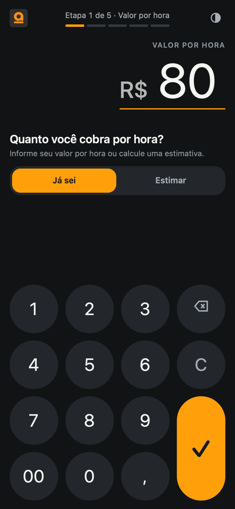
  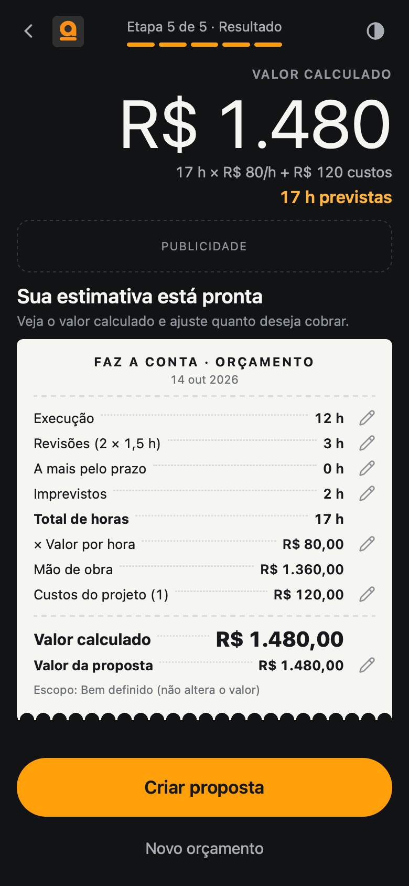
  
</p>

---

## Como funciona

A ferramenta parece uma calculadora: o **visor** é o próprio campo e mostra o subtotal a cada etapa.

| Etapa | O que você informa |
| --- | --- |
| 1 · Valor por hora | Quanto você cobra por hora, ou uma **estimativa** a partir da meta mensal ÷ horas que você consegue cobrar por semana |
| 2 · Execução | Horas de execução (sem revisões) e, opcionalmente, se o escopo já está definido |
| 3 · Prazo e revisões | Data de entrega, rodadas × horas por rodada e horas a mais pelo prazo |
| 4 · Ajustes | Horas para imprevistos e custos do projeto (licenças, fontes, impressão…) |
| 5 · Resultado | Cupom com a composição completa; cada linha é editável ali mesmo |

**A conta, sem percentuais mágicos:**

```text
horas_revisão   = rodadas × horas_por_rodada
horas_totais    = execução + horas_revisão + horas_a_mais_pelo_prazo + horas_para_imprevistos
valor_calculado = horas_totais × valor_por_hora + custos_do_projeto
```

A data de entrega e a definição do escopo **não mudam o valor**. O **valor da proposta** (o que o cliente vê) começa igual ao valor calculado e pode ser ajustado sem alterá-lo; se o cálculo mudar depois, o app avisa e oferece voltar ao valor calculado. Dinheiro é calculado em centavos inteiros, com um único arredondamento no fim.

A estimativa de valor por hora é um ponto de partida: **não** considera custos, impostos, férias ou margem, e não é preço de mercado.

### Proposta
Depois do resultado, você preenche nome do projeto, o que será entregue e condições/observações. A proposta sai como um cupom e pode ser **compartilhada** (menu nativo do celular), enviada pelo **WhatsApp**, **copiada** ou **impressa/salva em PDF**. As horas e a fórmula ficam de fora; o cliente vê o valor, a entrega, as revisões incluídas e os custos do projeto listados com descrição.

### O que fica salvo
- **No aparelho:** valor por hora e tema claro/escuro ("Apagar valor salvo" limpa os dois lugares: o aparelho e o campo).
- **Só nesta aba:** o orçamento em andamento. Recarregar a página não perde nada; fechar a aba descarta. Não há histórico nem envio de dados a servidores.

---

## Telas

### Mobile, uma dobra por tela

| Valor por hora | Estimar valor por hora | Execução | Prazo e revisões |
| --- | --- | --- | --- |
|  | 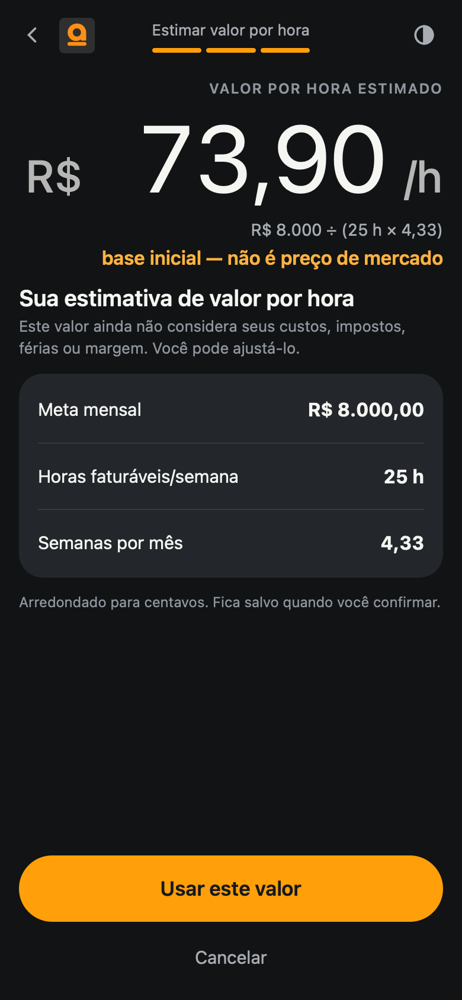 | 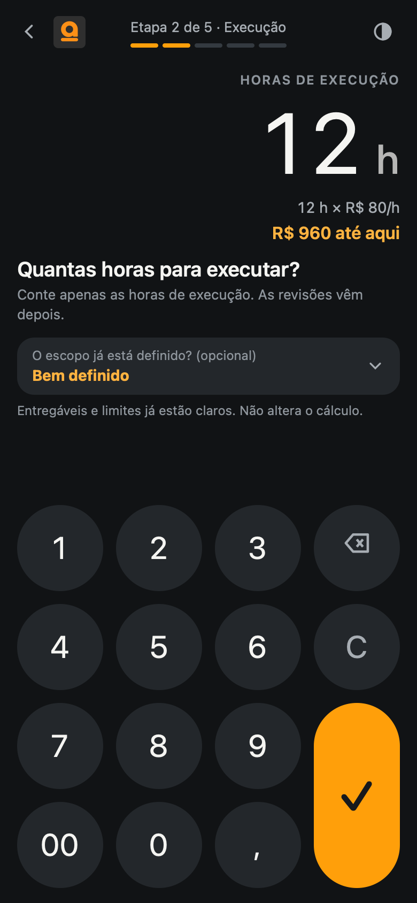 | 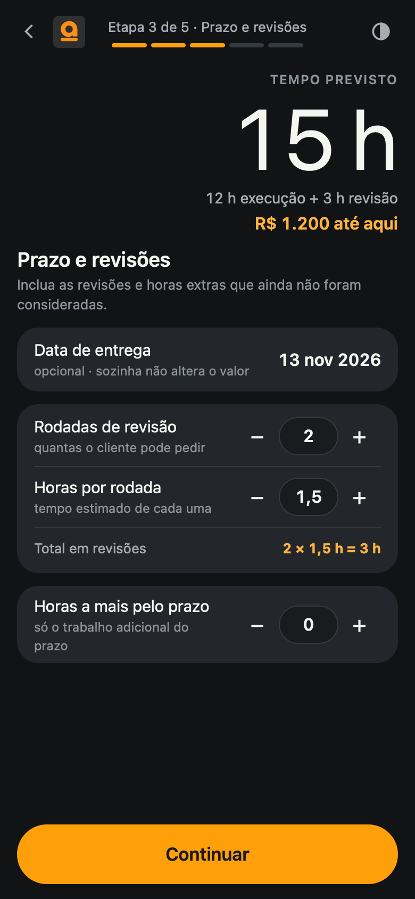 |

| Ajustes | Resultado (cupom) | Dados da proposta | Proposta pronta |
| --- | --- | --- | --- |
| 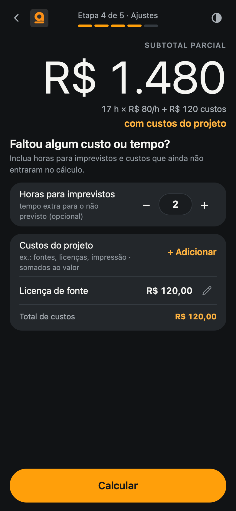 |  | 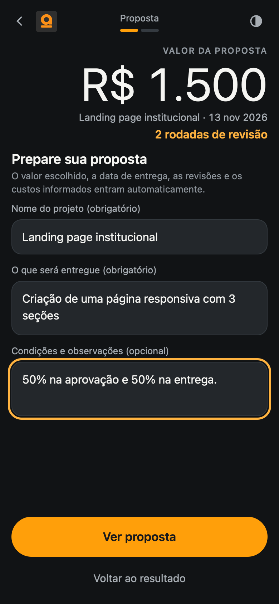 |  |

| Calendário (modal) | Adicionar custo (modal) | Valor da proposta (modal) | Guia |
| --- | --- | --- | --- |
| 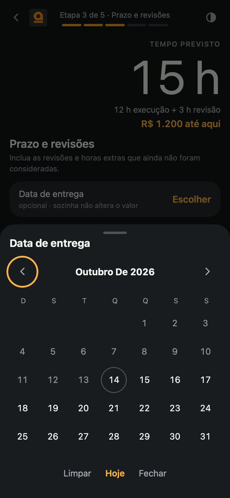 | 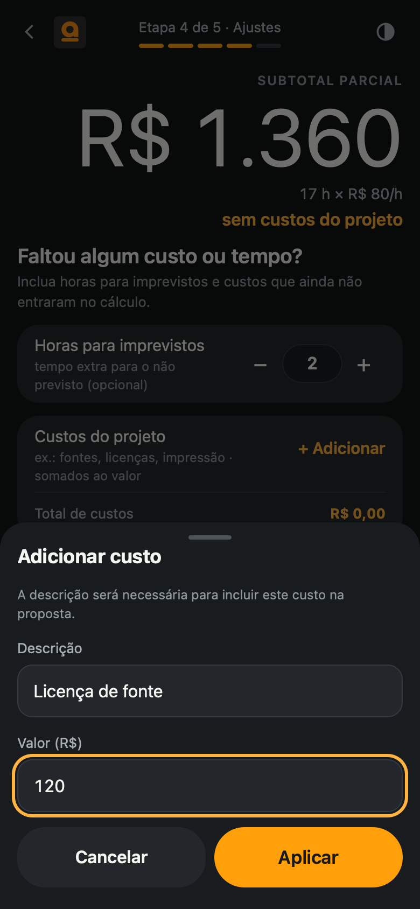 | 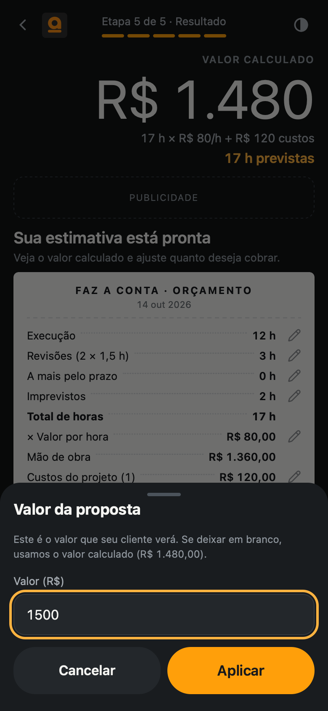 | 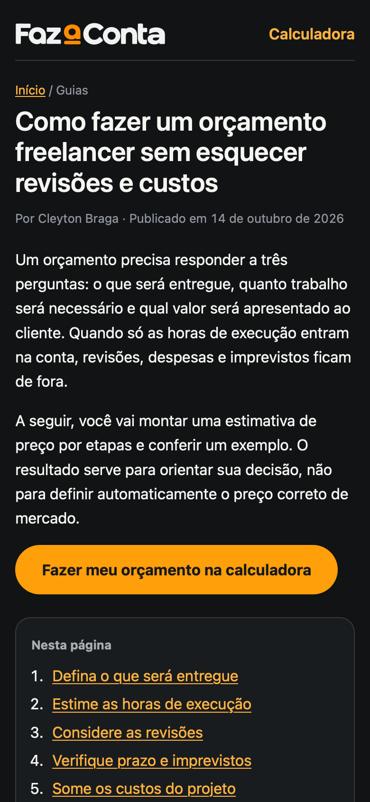 |

Tema claro:

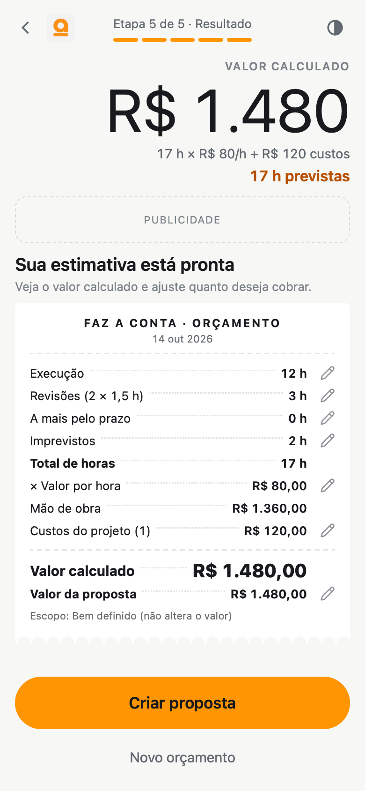 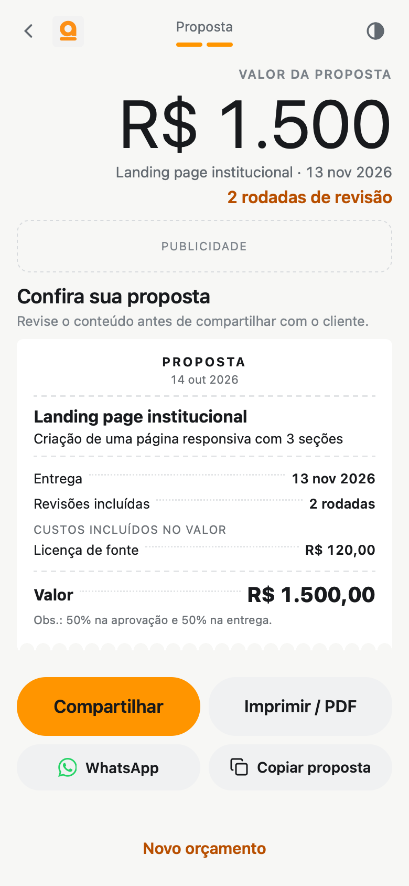

### Desktop
Trilha de etapas à esquerda, calculadora no centro e **orçamento impresso ao vivo** à direita.

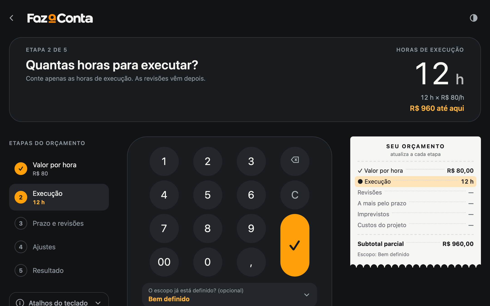
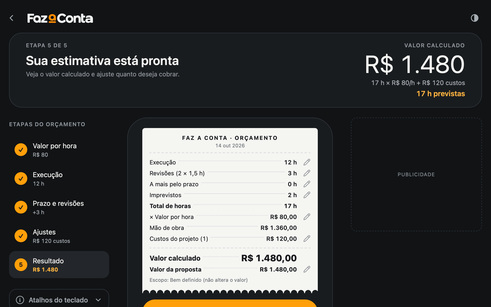
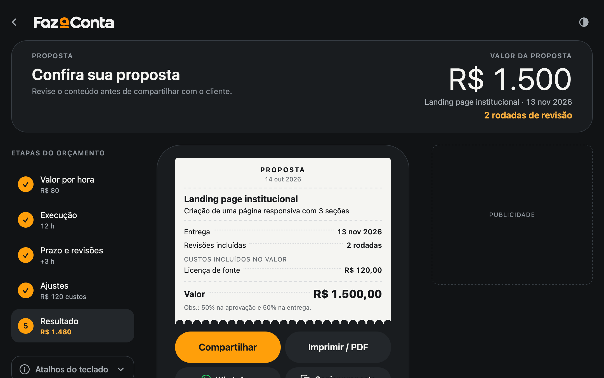
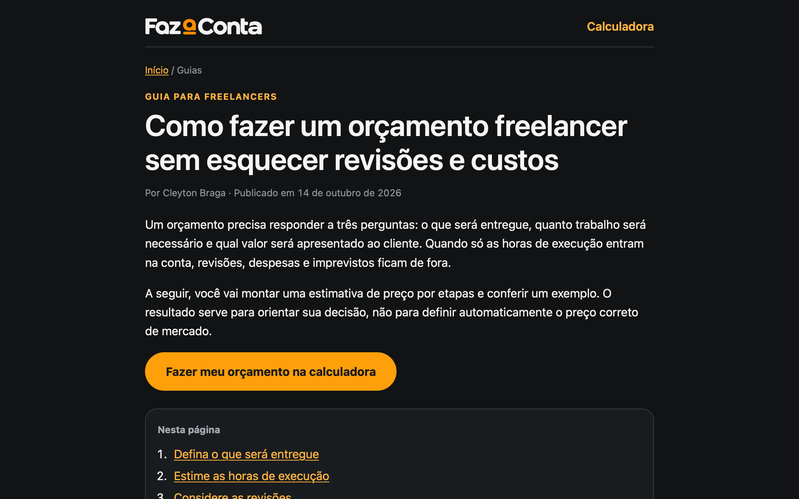

Atalhos no desktop: dígitos, `,` e `00` para digitar, `↑ ↓` somam/subtraem 1, `Enter` confirma, `Backspace` corrige e `Esc` volta.

*Prints anteriores (marca provisória "Quanto Cobro?") ficam em `docs/screenshots/` como histórico.*

---

## Rodar localmente

Não há build nem dependências. Basta servir a pasta:

```bash
python3 -m http.server 8790
# abra http://localhost:8790
```

Qualquer servidor estático serve (`npx serve`, GitHub Pages, Vercel, Netlify). Abrir o `index.html` direto do disco não funciona, porque módulos ES exigem HTTP. Ao mudar CSS/JS, incremente o `?v=N` no `index.html` (e no guia) para furar o cache do navegador.

### Testes

```bash
node test.mjs                 # regras de cálculo, entrada, proposta e datas
node docs/calc-reference.mjs  # casos contratuais do Business Rules
```

---

## Estrutura

```text
index.html          a calculadora (rota /), metadados, Open Graph e rodapé com link para o guia
styles.css          tokens do Design System (dark/light) e layouts mobile/desktop
calc.js             regras de negócio puras (sem DOM), testadas por test.mjs
app.js              estado, telas, modais e eventos
test.mjs            testes com node:assert, sem framework
assets/             logo e ícones da marca (claro/escuro), apple-touch-icon e imagem de compartilhamento
guias/              conteúdo editorial estático (SEO), sem depender de JavaScript
sitemap.xml         páginas publicadas, enviado ao Google Search Console
docs/               PRD, arquitetura, Business Rules, Design System, handoff e decision log
docs/screenshots/v2 imagens deste README (versão atual)
docs/historico      versões anteriores dos documentos e materiais de apoio
```

HTML, CSS e JavaScript puros, sem framework nem dependências. O desenho de ícones vem do [Lucide](https://lucide.dev) (ISC) e do [Simple Icons](https://simpleicons.org) (CC0).

---

## Documentação

| Documento | Para quê |
| --- | --- |
| [Decision Log](docs/decision-log.md) | Decisões aprovadas QC-DEC-001 a 021 e histórico; **fonte de verdade** em caso de conflito |
| [Business Rules](docs/business-rules.md) | Validações, obrigatórios, arredondamento, limites, persistência e casos-teste |
| [PRD](docs/PRD.md) | Escopo do MVP, jornadas e métricas |
| [Arquitetura](docs/architecture.md) | Modelo de dados, função de cálculo e rotas |
| [Design System](docs/design-system.md) | Tokens, componentes, estados e vocabulário de interface |
| [Handoff técnico](docs/handoff_tecnico.md) | Contratos e critérios de aceite |
| [Leia primeiro](docs/LEIA_PRIMEIRO.md) | Guia de leitura do pacote (nesta pasta, `atuais/` = `docs/`) |

Os documentos em `docs/` ainda usam o nome de trabalho "Quanto Cobro?" e a nomenclatura anterior da interface.

### Design

| Arquivo | Link |
| --- | --- |
| Figma: arquivo | https://www.figma.com/design/87RIlysRO3vHEDm7Ghdzf3 |
| Figma: marca e favicon | https://www.figma.com/design/87RIlysRO3vHEDm7Ghdzf3?node-id=125-72 |
| Figma: Mobile v1.4 | https://www.figma.com/design/87RIlysRO3vHEDm7Ghdzf3?node-id=100-2 |
| Figma: Desktop, Variante D (aprovada) | https://www.figma.com/design/87RIlysRO3vHEDm7Ghdzf3?node-id=115-2 |
| Figma: variações de desktop A–D | https://www.figma.com/design/87RIlysRO3vHEDm7Ghdzf3?node-id=107-2 |
| FigJam: fluxos e sitemap | https://www.figma.com/board/LoGu3vG6gQtt9KEGnAJ9CA?node-id=17-389 |
| FigJam: atualização das regras | https://www.figma.com/board/LoGu3vG6gQtt9KEGnAJ9CA?node-id=26-639 |

Os arquivos do Figma são privados; o acesso depende de convite.

---

## Status (14/10/2026)

**No ar**
- ✅ MVP completo: cálculo, estimativa de valor por hora, resultado editável, proposta, dark/light, mobile e desktop.
- ✅ Marca **Faz a Conta**: logo, favicon (claro/escuro), ícone para tela inicial e imagem de compartilhamento (Open Graph/X).
- ✅ Revisão de UX writing: "valor calculado" × "valor da proposta", termos consistentes, mensagens de erro e de compartilhamento revisadas.
- ✅ SEO: primeiro guia editorial, canonical, `sitemap.xml`, link para o guia no rodapé da calculadora.
- ✅ Google Search Console verificado, sitemap enviado e indexação solicitada para a home e o guia.

**Próximos passos**
- ⏳ Analytics: GA4 com aviso de consentimento (LGPD) e eventos do funil (início, resultado, proposta, compartilhamento).
- ⏳ Rede de anúncios: espaços já reservados (mobile 320×50 no resultado/proposta; desktop 300×250 na lateral).
- ⏳ Domínio próprio (ou novo caminho `/fazaconta/`), com redirecionamento do endereço atual.
- ⏳ Guias 2 e 3 (valor por hora, revisões) e o índice `/guias/` quando houver três guias.
- ⏳ Limite máximo específico por campo nas mensagens de erro; atualizar a documentação em `docs/` para a marca e a copy novas.
